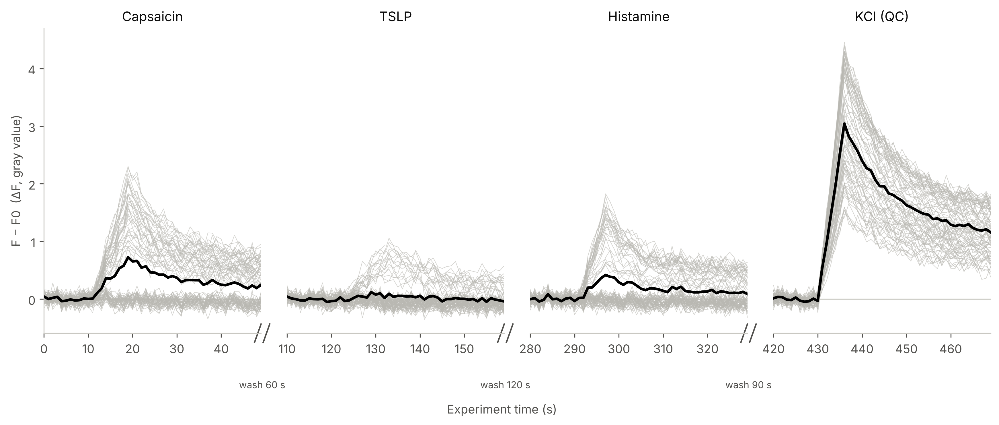
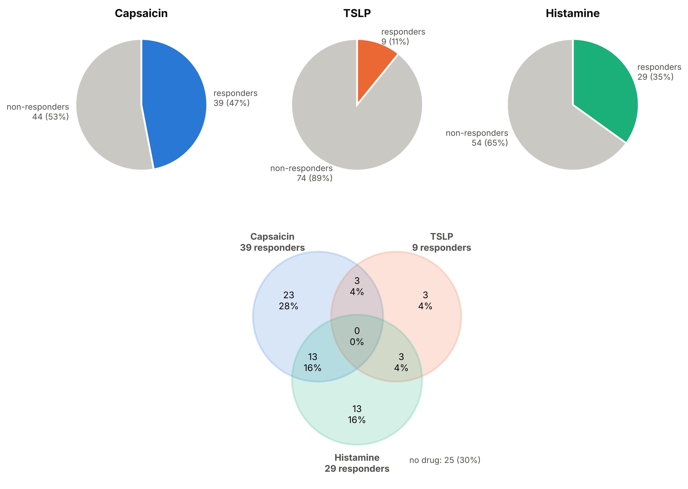
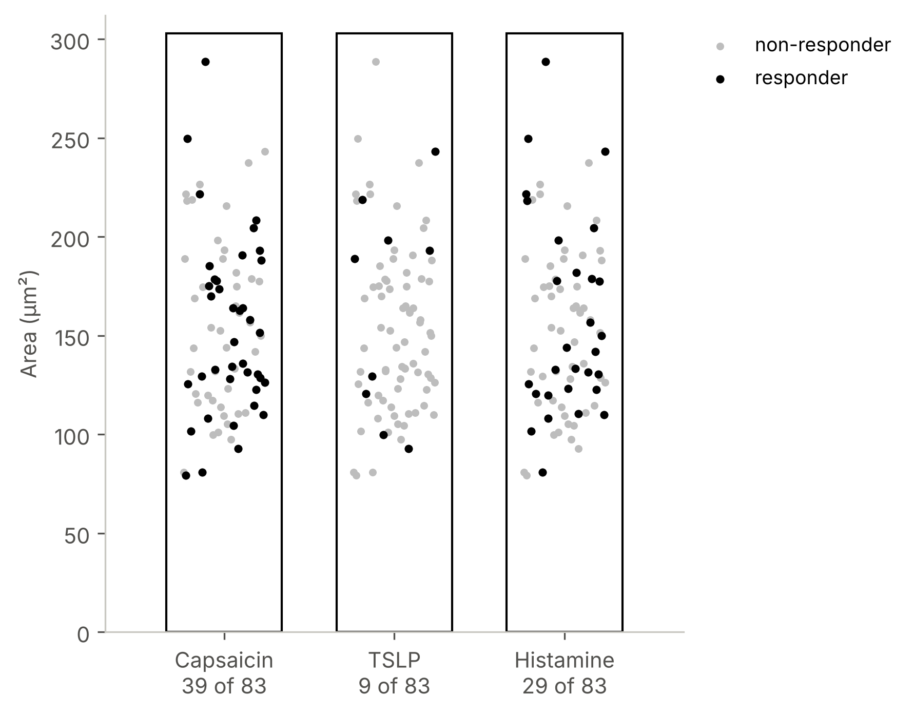
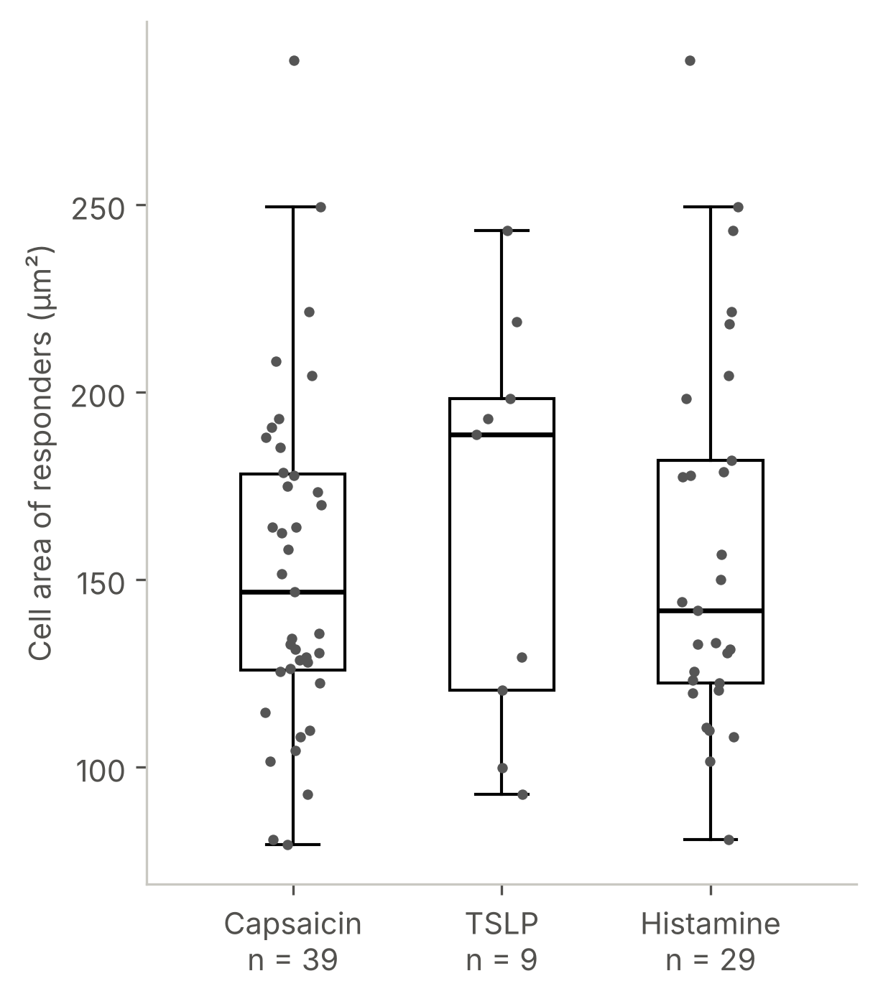

# Calcium Imaging Analysis with Python

The purpose of this toolbox is to analyse **calcium imaging** time-lapse data (e.g. Fluo-4) in which
several drugs are applied one after another to the **same field of view**, each drug recorded as its own
movie, with washes in between. Cells are outlined automatically with **Cellpose-SAM**, their **mean gray
values** are measured in **ImageJ**, and Python finds, for every cell, **which drugs it responded
to** (threshold: mean baseline + 5 × SD), keeps only cells that pass a **quality-control drug** (e.g. KCl
or ionomycin), adds the **cell size**, and draws the graphs.

**All steps in detail, from the microscope to the graphs: [STEPS.md](STEPS.md)**


## Installation instructions

1. Install **ImageJ**: <https://imagej.net/ij/download.html> → download for your system and unzip.
   For drift correction (only if needed) also install the **StackReg** and **TurboReg** plugins
   (<https://bigwww.epfl.ch/thevenaz/stackreg/>).
2. Install **Miniforge** (Python + conda): <https://github.com/conda-forge/miniforge>.
3. Download this repository: **Code → Download ZIP** and unzip it, or
   ```bash
   git clone https://github.com/yashadarsh1608/calcium-imaging.git
   cd calcium-imaging
   ```
4. Create the Python environment once (Linux/macOS: terminal; Windows: *Miniforge Prompt*):
   ```bash
   conda env create -f environment.yml
   conda activate cellpose
   ```
   Only the analysis and graphs (Cellpose in Google Colab)? `pip install -r requirements.txt` is enough.
5. Every time you open a new terminal: `conda activate cellpose`.
6. Put the scripts you need into your experiment folder (or run them with their full path).

Details and checks: [STEPS.md → Step 0](STEPS.md#step-0--installation).

## Part 1: Outline the cells (Cellpose-SAM)

**Description:** Draws one outline (ROI) per cell on the brightfield image of the field and saves them
as an ImageJ ROI zip. Segment **once** per experiment; the same ROIs are used for every movie, so every
cell keeps its number across all drugs.

**Filename:** `notebooks/cellpose_colab.ipynb` (Google Colab, free GPU) **or**
`scripts/segment_cells.py` (your own computer; same code, same Cellpose version 4.2.1.1)

**Important considerations:**
- The brightfield image must have the **same size** as the movies (same camera, binning, crop).
- Start with `DIAMETER = 0`; change `CELLPROB_THRESHOLD` if cells are missed (`-1`) or debris is outlined (`1`).
- `scripts/compare_rois.py` checks that Colab and your computer give the same ROIs.

**To run this program:** Colab: open the notebook, Runtime → T4 GPU, run the 4 cells.
Computer: `python segment_cells.py` → output `brightfield_rois.zip`.

## Part 2: Measure the cells (ImageJ)

**Description:** Loads the ROIs on every movie, adds 3 empty background boxes, and measures the mean gray
value of every ROI in every frame (one CSV per movie). Optionally measures the area of every cell once.

**Filename:** no code; step-by-step in [STEPS.md → Steps 4–6](STEPS.md#step-4--rois-and-background-boxes-imagej).

**Important considerations:**
- The 3 background boxes must be **empty, flat in every movie** and the **last 3 ROIs**.
- Measure **every movie with the same ROI zip** (ROI Manager → More → Multi Measure, *Measure all
  slices*, *One row per slice*).
- Never save the movies in ImageJ; always *Cancel* "Apply LUT".

**Output:** `drug1.csv`, `drug2.csv`, …, `kcl.csv` (rows = frames, columns = `Mean(1)` … one per ROI,
background boxes last) and optionally `cell_size.csv`.

## Part 3: Identify % of cells that responded to each drug and the quality control

**Description:** For every cell and every movie: background subtraction, baseline (Bavg), ΔF = X − Bavg,
responder if the mean ΔF in the peak window > mean baseline + 5 × SD. Only cells that respond to the
quality-control drug are analysed. Gives responders per drug, the combinations (which cells respond to
which drugs), ΔF/F0, ΔF normalised to the QC response, and the cell size.

**Filename:** `scripts/calcium_multidrug.py`

**Important considerations:**
- Input: the CSV files from Part 2 (comma or German semicolon format, both work).
- The script **asks every setting** (files, drug names, baseline, peak window, threshold, washing times,
  QC drug, cell size, pixel size). `[value]` = suggestion (ENTER), `(required)` = must be typed.
- Run `python calcium_multidrug.py --overview` first to see where each movie rises and peaks.
- For a drug with no response, choose the peak window from when the drug was added; its cells are
  simply counted as non-responders.

**To run this program:** `python calcium_multidrug.py`

**Output:** `multidrug_results/multidrug_results.xlsx` + the same tables as CSV: Summary, Responders
(yes/no per drug per cell), Combinations, QC, Excluded_cells, Per_cell, Cell_size, Mean_traces,
Cell_traces, Settings, Raw data.

## Part 4: Graphs

**Description:** Draws the graphs from the result tables (the analysis is not repeated).

| Graph | Shows |
|---|---|
| `1_traces_all_recordings` | ΔF (F − F0) over time of every recording incl. the QC drug: every cell grey, mean black, `//` = washing |
| `2_pies_and_venn` | one pie per drug (responders / non-responders) + Venn diagram of the overlap |
| `3_area_scatter` | cell area per drug, every cell one dot (black = responder, grey = non-responder) |
| `4_area_responders_box` | box-and-whisker of the cell area of the responders only |

**Filename:** `scripts/make_graphs.py`

**To run this program:** `python make_graphs.py` (in the folder that contains `multidrug_results/`) →
`multidrug_results/graphs/` (png, pdf or svg).

| | |
|---|---|
|  |  |
|  |  |

*(synthetic example data)*

## Try it with the example data

`examples/data/` contains **synthetic** (made-up) data in the ImageJ format: 3 drugs + KCl, 97 cells.

```bash
cd examples/data
python ../../scripts/calcium_multidrug.py < ../answers_example.txt
python ../../scripts/make_graphs.py          # press ENTER at every question
```

## Repository contents

| File / folder | Content |
|---|---|
| [STEPS.md](STEPS.md) | **every step in detail**, from recording to graphs, incl. the method and troubleshooting |
| `notebooks/cellpose_colab.ipynb` | Part 1 in Google Colab |
| `scripts/segment_cells.py` | Part 1 on your computer |
| `scripts/compare_rois.py` | compares two ROI sets (e.g. Colab vs computer) |
| `scripts/calcium_multidrug.py` | Part 3, the analysis |
| `scripts/make_graphs.py` | Part 4, the graphs |
| `examples/` | synthetic example data + answers file |
| `docs/images/` | the example graphs shown here |
| `environment.yml`, `requirements*.txt` | Python packages |

No real experiment data is in this repository; `.gitignore` keeps movies, CSV files and results out of Git.

## Citation

Please cite Cellpose (Pachitariu, Rariden & Stringer, 2025, *Cellpose-SAM*, bioRxiv) and ImageJ
(Schneider, Rasband & Eliceiri, 2012, *Nature Methods* 9, 671–675).

## License

MIT, see [LICENSE](LICENSE).
