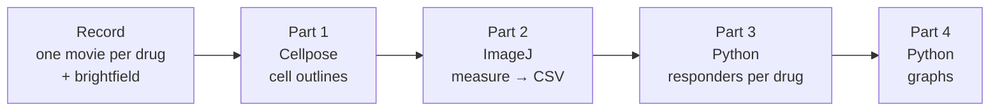

# Calcium Imaging Analysis with Python

**Cellpose → ImageJ → Python:** which cells respond to which drug, when several drugs are applied one
after another to the same cells.

  

[Quick start](#quick-start-for-new-users) · [All steps](STEPS.md) · [The window](#part-3--4-in-one-window-gui) · [Graphs](#part-4-graphs) · [Method](STEPS.md#method) · [Troubleshooting](STEPS.md#troubleshooting)


## What it does

The purpose of this toolbox is to analyse **calcium imaging** time-lapse data (e.g. Fluo-4) in which
several drugs are applied one after another to the **same field of view**, each drug recorded as its own
movie, with washes in between. Cells are outlined automatically with **Cellpose-SAM**, their **mean gray
values** are measured in **ImageJ**, and Python finds, for every cell, **which drugs it responded
to** (threshold: mean baseline + 5 × SD), keeps only cells that pass a **quality-control drug** (e.g. KCl
or ionomycin), adds the **cell size**, and draws the graphs.

**All steps in detail, from the microscope to the graphs: [STEPS.md](STEPS.md)**



Parts 3 and 4 can be done in **one window** (`scripts/calcium_gui.py`, in the style of the Cellpose
window) or from the command line; both use the same code and give the same results.

## Quick start for new users

You do not need to know Python. You need a computer with ImageJ, and your recordings: **one movie per
drug of the same cells**, the quality-control drug (e.g. KCl) last, and one brightfield image.

| | What you do | Where | Details |
|---|---|---|---|
| **Once** | Install ImageJ and Miniforge, download this repository, create the environment (4 commands, see below) | terminal | [Step 0](STEPS.md#step-0--installation) |
| **1** | Outline the cells on the brightfield image → `brightfield_rois.zip` | Google Colab notebook (no installation) or `segment_cells.py` | [Step 3](STEPS.md#step-3--outline-the-cells-cellpose) |
| **2** | Load the outlines in ImageJ, add 3 empty background boxes, **Multi Measure** every movie and save each table as CSV (`drug1.csv` … `kcl.csv`); measure the cell size once (`cell_size.csv`) | ImageJ | [Steps 4–6](STEPS.md#step-4--rois-and-background-boxes-imagej) |
| **3** | Start the window, open the folder with the CSV files, type the drug names and the peak frames, press **Run analysis** | `calcium_gui.py` | [Step 7](STEPS.md#step-7--analysis-python) |
| **4** | Look at the Summary and the five graphs; everything is saved in `multidrug_results/` next to your CSV files | the window | [Step 8](STEPS.md#step-8--graphs-python) |

Every time you want to analyse an experiment, only this is typed in the terminal:

```bash
conda activate cellpose
cd calcium-imaging
python scripts/calcium_gui.py
```

Your data never leaves your computer and is never uploaded to GitHub.

## Installation instructions

1. Install **ImageJ**: <https://imagej.net/ij/download.html> → download for your system and unzip.
2. Install **Miniforge** (Python + conda): <https://github.com/conda-forge/miniforge>.
3. Download this repository: **Code → Download ZIP** and unzip it, or
   ```bash
   git clone https://github.com/yashadarsh1608/calcium-imaging.git
   cd calcium-imaging
   ```
4. Create the Python environment once (Linux/macOS: terminal; Windows: *Miniforge Prompt*):
   ```bash
   conda env create -f environment.yml
   conda activate cellpose
   ```
   Only the analysis and graphs (Cellpose in Google Colab)? `pip install -r requirements.txt` is enough.
5. Every time you open a new terminal: `conda activate cellpose`.
6. To get the newest version later, run `git pull` in the repository folder (the window also does this
   by itself when it starts).
7. The window is started from the repository folder. For the command-line scripts, put the scripts you
   need into your experiment folder (or run them with their full path).

Details and checks: [STEPS.md → Step 0](STEPS.md#step-0--installation).

## Part 1: Outline the cells (Cellpose-SAM)

**Description:** Draws one outline (ROI) per cell on the brightfield image of the field and saves them
as an ImageJ ROI zip. Segment **once** per experiment; the same ROIs are used for every movie, so every
cell keeps its number across all drugs.

**Filename:** `notebooks/cellpose_colab.ipynb` (Google Colab, free GPU) **or**
`scripts/segment_cells.py` (your own computer; same code, same Cellpose version 4.2.1.1)

**Important considerations:**
- The brightfield image must have the **same size** as the movies (same camera, binning, crop).
- Start with `DIAMETER = 0`; change `CELLPROB_THRESHOLD` if cells are missed (`-1`) or debris is outlined (`1`).
- `scripts/compare_rois.py` checks that Colab and your computer give the same ROIs.

**To run this program:** Colab: open the notebook, Runtime → T4 GPU, run the 4 cells.
Computer: `python segment_cells.py` → output `brightfield_rois.zip`.

## Part 2: Measure the cells (ImageJ)

**Description:** Loads the ROIs on every movie, adds 3 empty background boxes, and measures the mean gray
value of every ROI in every frame (one CSV per movie), also measures the area of every cell once.

**Filename:** no code; step-by-step in [STEPS.md → Steps 4–6](STEPS.md#step-4--rois-and-background-boxes-imagej).

**Important considerations:**
- The 3 background boxes must be **empty, flat in every movie** and the **last 3 ROIs**.
- Measure **every movie with the same ROI zip** (ROI Manager → More → Multi Measure, *Measure all
  slices*, *One row per slice*).
- Never save the movies in ImageJ; always *Cancel* "Apply LUT".

**Output:** `drug1.csv`, `drug2.csv`, …, `kcl.csv` (rows = frames, columns = `Mean(1)` … one per ROI,
background boxes last) and optionally `cell_size.csv`.

## Part 3 + 4 in one window (GUI)

**Description:** A window for everything after ImageJ: open the folder with the CSV files, name the recordings,
set the baseline and peak windows while looking at the traces, run the analysis and see the results and
all graphs. It calls the same code as the command-line scripts below, so the results are identical.

**Filename:** `scripts/calcium_gui.py`

**To run this program:**
```bash
conda activate cellpose
cd calcium-imaging
git pull                         # newest version
python scripts/calcium_gui.py
```

**How to use it:**
1. **Open folder…** → the folder with the CSV files from ImageJ (every recording in it is listed), **or
   Add CSV files…** → choose the files themselves, **or drag** the folder or the files into the window.
   A file with `kcl`, `iono` or `qc` in its name is set as the quality control (QC), `cell_size.csv` as
   the size file.
2. In the table: put the rows in the **order of the experiment** (↑ ↓), type the **drug names**, set
   **Role** (Drug / QC), **Baseline** (e.g. `1-8`), **Peak** (e.g. `15-25`, must be typed), **SD** (5),
   **Drug at** (frame at which the drug was added) and the **Wash** time after each recording.
3. The **Overview** tab shows every recording (median cell, middle 50 %, top 10 % of cells) with the
   baseline (grey) and peak window (orange) drawn in; it updates while you type. Warnings about
   background boxes or a rising baseline appear under Messages.
4. **Measurement:** background boxes, time between frames, cell size file, pixel size.
   **Quality control:** the two extra rules (late response, minimum QC ΔF/F0).
5. **Run analysis** → the **Summary** tab and the five graph tabs fill; tables and graphs are saved in
   `multidrug_results/`. **Save graphs** saves them again as png, pdf or svg. If no recording has the role
   QC, the window asks before it runs without quality control.
6. The settings of every folder are remembered (`calcium_gui_session.json`) and restored the next time.

| Overview: set the baseline and peak windows | Summary after the run |
|---|---|
|  |  |

## Part 3: Identify % of cells that responded to each drug and the quality control

**Description:** For every cell and every movie: background subtraction, baseline (Bavg), ΔF = X − Bavg,
responder if the mean ΔF in the peak window > mean baseline + 5 × SD. Only cells that respond to the
quality-control drug are analysed; two more rules remove a cell if its QC response is tiny (peak ΔF/F0
below 0.0001) or if its response to a drug starts later than 40 s after the drug was added (both numbers
can be changed or switched off). Gives responders per drug, the combinations (which cells respond to
which drugs), ΔF/F0, ΔF normalised to the QC response, and the cell size.

**Filename:** `scripts/calcium_multidrug.py` (command line; the window runs the same code)

**Important considerations:**
- Input: the CSV files from Part 2, exactly as ImageJ saves them.
- The script **asks every setting** (files, drug names, baseline, peak window, threshold, washing times,
  QC drug, cell size, pixel size). `[value]` = suggestion (ENTER), `(required)` = must be typed.
- Run `python calcium_multidrug.py --overview` first to see where each movie rises and peaks.
- For a drug with no response, choose the peak window from when the drug was added; its cells are
  simply counted as non-responders.

**To run this program:** `python calcium_multidrug.py`

**Output:** `multidrug_results/multidrug_results.xlsx` + the same tables as CSV: Summary, Responders
(yes/no per drug per cell), Combinations, QC, Excluded_cells, Per_cell, Cell_size, Mean_traces,
Cell_traces, Settings, Raw data.

## Part 4: Graphs

**Description:** Draws the graphs from the result tables (the analysis is not repeated). Every graph
uses only the cells that are kept after the quality-control drug.

| Graph | Shows |
|---|---|
| `1_traces_cells` | F − F0 over time of every recording incl. the QC drug: every cell one line, `//` = washing |
| `2_drug_and_QC` | one row per drug, **only the cells that responded to that drug**: their response to the drug on the left and the response of the same cells to the QC drug on the right; every cell grey, mean black |
| `3_pies_and_venn` | black and grey: one pie per drug (responders / non-responders) + the overlap between the drugs. 2–3 drugs: Venn diagram with circle sizes proportional to the number of responders. 4 or more drugs: bar chart of every combination |
| `4_area_scatter` | cell area per drug, every cell one dot (black = responder, grey = non-responder) |
| `5_area_responders_box` | box-and-whisker of the cell area of the responders only |

**Filename:** `scripts/make_graphs.py` (command line; the window shows the same graphs)

**To run this program:** `python make_graphs.py` (in the folder that contains `multidrug_results/`) →
`multidrug_results/graphs/` (png, pdf or svg).


| | |
|---|---|
|  |  |
|  |  |

*(synthetic data)*

## Repository contents

| File / folder | Content |
|---|---|
| [STEPS.md](STEPS.md) | **every step in detail**, from recording to graphs, incl. the method and troubleshooting |
| `notebooks/cellpose_colab.ipynb` | Part 1 in Google Colab |
| `scripts/segment_cells.py` | Part 1 on your computer |
| `scripts/compare_rois.py` | compares two ROI sets (e.g. Colab vs computer) |
| `scripts/calcium_gui.py` | **the window**: Parts 3 and 4 with buttons |
| `scripts/calcium_multidrug.py` | Part 3, the analysis (command line) |
| `scripts/make_graphs.py` | Part 4, the graphs (command line) |
| `docs/Images/` | the pictures shown here |
| `environment.yml`, `requirements*.txt` | Python packages |

No real experiment data is in this repository; `.gitignore` keeps movies, CSV files and results out of Git.

## Reference

The analysis method (background subtraction, baseline mean, responder threshold of mean + 5 × SD, and
normalisation to a positive control such as ionomycin or KCl) follows the R toolbox
[Calcium-Imaging-Analysis-with-R](https://github.com/amapruns/Calcium-Imaging-Analysis-with-R)
by amapruns, in particular
[`Normalization_ionomycin.R`](https://github.com/amapruns/Calcium-Imaging-Analysis-with-R/blob/master/Normalization_ionomycin.R).
This repository reimplements and extends it in Python (several drugs, quality-control filter, cell size,
Cellpose segmentation, graphs, window).

## Citation

Please cite Cellpose (Pachitariu, Rariden & Stringer, 2025, *Cellpose-SAM*, bioRxiv) and ImageJ
(Schneider, Rasband & Eliceiri, 2012, *Nature Methods* 9, 671–675).

## License

MIT, see [LICENSE](LICENSE).