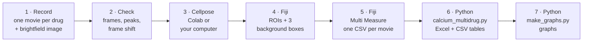
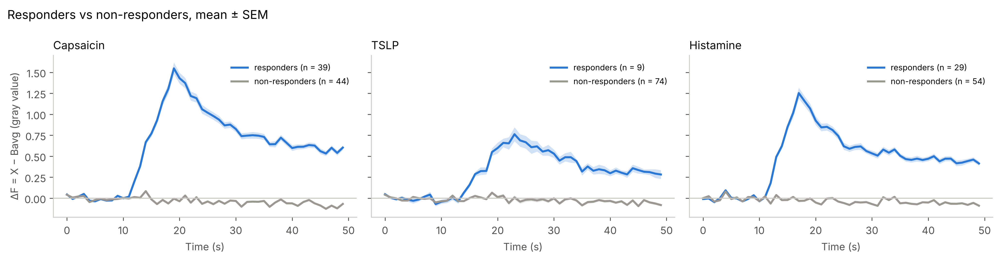
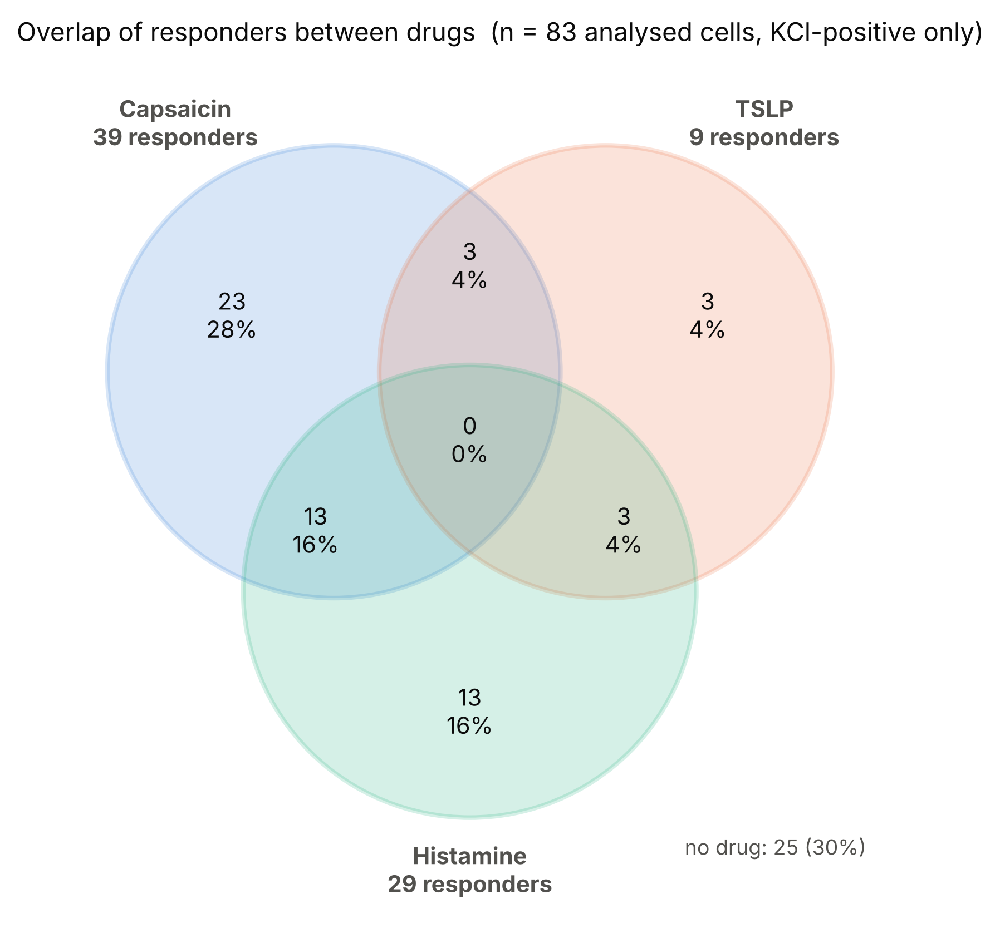

# Calcium imaging analysis pipeline

From a time-lapse calcium imaging experiment to a table that says, for every cell, **which drugs it
responded to**. Cells are outlined automatically with **Cellpose-SAM**, measured in **Fiji/ImageJ**, and
analysed with **Python**: background subtraction, baseline, ΔF, a responder threshold
(mean baseline + 5 SD), an optional quality-control drug (e.g. KCl) and the cell size.

It is made for experiments where several drugs are applied one after another to the **same field of
view**, each drug recorded as its own movie, with washes in between that are not imaged.



| Step | Guide | Tool | You get |
|---|---|---|---|
| 0 Install | [docs/00_installation.md](docs/00_installation.md) | Fiji, Miniforge | a `cellpose` environment |
| 1 Record | [docs/01_recording.md](docs/01_recording.md) | microscope | `drug1.tif` … `kcl.tif`, `brightfield.tif` |
| 2 Check recordings and frame shift | [docs/02_check_recordings.md](docs/02_check_recordings.md) | Fiji | frames, peak frames, drift yes/no |
| 3a Segment in Google Colab | [docs/03a_cellpose_colab.md](docs/03a_cellpose_colab.md) | [notebook](notebooks/cellpose_colab.ipynb) | `brightfield_rois.zip` |
| 3b … or on your own computer | [docs/03b_cellpose_local.md](docs/03b_cellpose_local.md) | `segment_cells.py` or the Cellpose window | `brightfield_rois.zip` |
| 4–5 ROIs, background, measure | [docs/04_imagej_measure.md](docs/04_imagej_measure.md) | Fiji | `drug1.csv` … `kcl.csv`, `cell_size.csv` |
| 6 Analysis | [docs/05_python_analysis.md](docs/05_python_analysis.md) | `calcium_multidrug.py` | `multidrug_results.xlsx` + CSV files |
| 7 Graphs | [docs/06_graphs.md](docs/06_graphs.md) | `make_graphs.py` | PNG / PDF / SVG graphs |
| Problems | [docs/07_troubleshooting.md](docs/07_troubleshooting.md) | | |
| The maths | [docs/method.md](docs/method.md) | | |

## Quick start

```bash
# 1. get the code
git clone https://github.com/<your-user-name>/calcium-imaging-pipeline.git
cd calcium-imaging-pipeline

# 2. one environment for everything (Cellpose + analysis), see docs/00_installation.md
conda env create -f environment.yml
conda activate cellpose

# 3. try it on the synthetic example data (no real data in this repository)
cd examples/data
python ../../scripts/calcium_multidrug.py < ../answers_example.txt
python ../../scripts/make_graphs.py          # press ENTER at every question
```

For your own experiment, put the CSV files from Fiji in one folder, open a terminal there and run
`python <path>/scripts/calcium_multidrug.py`. The script **asks every setting**; a value in
`[brackets]` is a suggestion (ENTER accepts it), `(required)` means you must type it.

## What is in the repository

```
calcium-imaging-pipeline/
├── notebooks/cellpose_colab.ipynb   Cellpose-SAM in Google Colab (free GPU)
├── scripts/
│   ├── segment_cells.py             the same Cellpose code, on your own computer
│   ├── compare_rois.py              do two segmentations give the same cells? (Colab vs computer)
│   ├── calcium_multidrug.py         the analysis: responders per drug, QC, size -> Excel + CSV
│   └── make_graphs.py               graphs from the result tables
├── examples/                        synthetic example data + answers to run it without typing
├── docs/                            step-by-step guides (start with 00_installation.md)
├── environment.yml                  conda environment: Cellpose + analysis
├── requirements.txt                 pip: analysis and graphs only
└── requirements-cellpose.txt        pip: Cellpose on your computer
```

## Example output (synthetic data)

| Responders vs non-responders | Overlap between drugs |
|---|---|
|  |  |

## Good to know

- **Data stays out of Git.** `.gitignore` excludes movies, CSV files (except the synthetic example) and
  result folders. Never commit confidential experiment data.
- **Same ROIs everywhere.** Segment once, measure every movie with the same ROI zip; the script stops
  if two CSV files have different ROI columns.
- **Colab and your computer give the same ROIs** when they use the same image, settings and Cellpose
  version (pinned to 4.2.1.1 in both). Check it on your own image with `compare_rois.py`.
- The analysis writes **tables only**; `make_graphs.py` draws from those tables, so graphs can be
  changed without repeating the analysis.

## Citation

If you use this pipeline, please cite Cellpose:
Pachitariu, M., Rariden, M., & Stringer, C. (2025). Cellpose-SAM: superhuman generalization for cellular
segmentation. *bioRxiv*. And Fiji: Schindelin, J. et al. (2012). Fiji: an open-source platform for
biological-image analysis. *Nature Methods* 9, 676–682.

## License

MIT, see [LICENSE](LICENSE).
