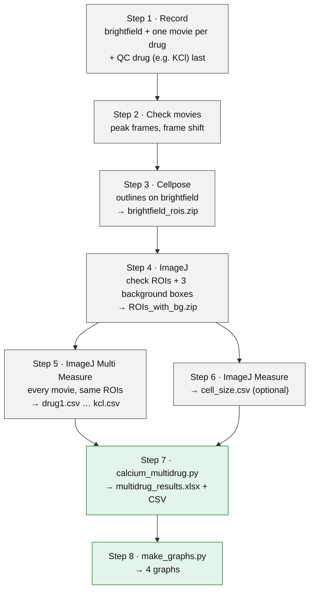
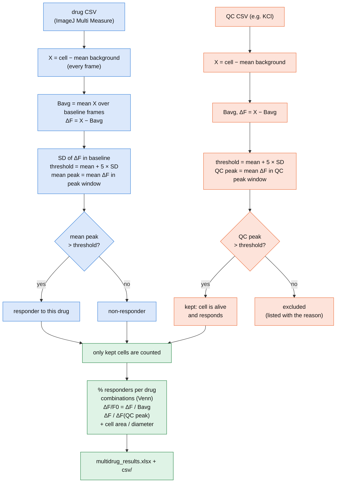

# Calcium imaging analysis: all steps

Every step from the microscope to the graphs, in order. Do them one after another; each step says what
you need, what to do and what you get.

| Step | Where | You get |
|---|---|---|
| [0 Installation](#step-0--installation) | computer | ImageJ, a `cellpose` Python environment |
| [1 Record](#step-1--record) | microscope | one movie per drug + QC drug, brightfield image |
| [2 Check the movies and frame shift](#step-2--check-the-movies-and-frame-shift-imagej) | ImageJ | frames, peak frames, drift yes/no |
| [3 Outline the cells](#step-3--outline-the-cells-cellpose) | Colab or computer | `brightfield_rois.zip` |
| [4 ROIs and background boxes](#step-4--rois-and-background-boxes-imagej) | ImageJ | `ROIs_with_bg.zip` |
| [5 Measure every movie](#step-5--measure-every-movie-imagej) | ImageJ | `drug1.csv` … `kcl.csv` |
| [6 Cell size (optional)](#step-6--cell-size-optional-imagej) | ImageJ | `cell_size.csv` |
| [7 Analysis](#step-7--analysis-python) | Python | `multidrug_results.xlsx` + CSV |
| [8 Graphs](#step-8--graphs-python) | Python | 4 graphs |
| [Flowcharts](#flowcharts) · [Script reference](#script-reference) · [Method](#method) · [Troubleshooting](#troubleshooting) | | |

---

## Flowcharts

### The whole pipeline



### The analysis of every cell (`calcium_multidrug.py`)

Blue = every **drug** movie, red = the **quality-control** movie (e.g. KCl), green = combining them.
Each movie is processed with its own baseline.



Without a QC drug the red part is skipped and every cell is analysed.

---

## Step 0 — Installation

Once per computer.

1. **ImageJ:** <https://imagej.net/ij/download.html> → download for your system → unzip → start ImageJ.
   Only if you need drift correction (Step 2e): also install the **StackReg** and **TurboReg** plugins from
   <https://bigwww.epfl.ch/thevenaz/stackreg/> (copy them into ImageJ's `plugins` folder, restart ImageJ).
2. **Miniforge** (Python): <https://github.com/conda-forge/miniforge> → installer for your system.
   Windows: afterwards use **Miniforge Prompt** from the Start menu as the terminal.
3. **This repository:** on GitHub **Code → Download ZIP**, unzip; or `git clone https://github.com/yashadarsh1608/calcium-imaging.git`.
4. **Python environment** (5–15 min), in the terminal inside the repository folder:
   ```bash
   conda env create -f environment.yml
   conda activate cellpose
   python -c "import cellpose, pandas, matplotlib, openpyxl, roifile; print('all good')"
   ```
   Already have a `cellpose` environment? `conda activate cellpose`, then
   `pip install -r requirements.txt` and `pip install "cellpose[gui]==4.2.1.1"`.
   Segmenting only in Google Colab? `pip install -r requirements.txt` is enough.
5. **Every new terminal:** `conda activate cellpose` first.

Optional GPU check: `python -c "import torch; print('GPU' if torch.cuda.is_available() else 'CPU only')"`.
Cellpose also runs on the CPU (minutes per image). The first run downloads the model (~1 GB).

---

## Step 1 — Record

**Rules**

- **Same field and same settings** (objective, exposure, binning, light) for every movie; do not move the stage.
- **Brightfield image** of the same field before the first drug, same camera settings.
- **Baseline:** at least **8 frames** before the drug reaches the cells (add it after frame 8–10).
- **One movie per drug** (e.g. 50 frames at 1 s). Washes between drugs need not be imaged.
- **Quality-control (QC) drug last**, as its own movie: **KCl** for excitable cells (neurons), **ionomycin**
  for non-excitable cells (e.g. HEK cells barely respond to KCl).
- **Triggered illumination** on (light only while the camera takes a frame) to reduce bleaching.
- **Add solutions gently**, away from the field, and do not touch the plate or stage (frame shift, Step 2).

**Write down** (the analysis asks for it): drug order, names, concentrations; frame at which each drug was
added; frames per movie and frame interval; washing time between movies; objective, camera, binning; pixel
size in µm (Micro-Manager: Devices → Pixel Size Calibration, or camera pixel size ÷ objective × binning,
e.g. 6.5 µm / 20 = 0.325 µm). The pixel size stored in the file can be wrong.

**Files:** one folder per experiment, simple names, never overwrite the raw movies:

```
2026-10-27_exp1/
├── brightfield.tif
├── drug1.tif   drug2.tif   drug3.tif
└── kcl.tif
```

---

## Step 2 — Check the movies and frame shift (ImageJ)

**2a · Frames and peaks.** Open each movie: the title shows e.g. `1/50; 3200x2200 pixels`. Draw a large
rectangle over many cells → **Image → Stacks → Plot Z-axis Profile**. Note the frame where the signal
**rises** and where it is **highest** → the **peak window** for Step 7 (e.g. peak at 18 → `15-21`).
A drug with no rise is fine (see Step 7).

**2b · Frame shift inside a movie.** Cells that do not move can still shift in the image (stage or plate
moves when solutions are added, thermal drift, focus drift).
1. Frame 1 → **Image → Duplicate…** (untick *Duplicate stack*) → `first`; last frame → `last`.
2. **Image → Color → Merge Channels…**: C1 red = `first`, C2 green = `last` → OK.
3. Zoom on cell edges: **yellow = no shift**; red on one side and green on the other = shift.

**2c · Frame shift between movies.** The same merge with the last frame of one movie and the first frame of
the next, and with the brightfield image against frame 1 of the first movie.

**2d · Decide.**

| What you see | Do |
|---|---|
| no shift or under 1–2 pixels | continue |
| a few pixels (under ~1/10 of a cell) | continue, note it |
| larger, or a jump at one frame | correct it (2e) |
| cells get blurry (focus drift) | cannot be corrected; note it, consider dropping that movie |

**2e · Correct a shift.** **Image → Stacks → Tools → Concatenate** (all movies in order) → **Plugins →
StackReg** (transformation *Translation*) → split back with **Image → Stacks → Tools →
Make Substack…** → save as `drug1_reg.tif`, … and use these. If the brightfield no longer matches, segment an
Average Intensity projection of the corrected stack instead.

---

## Step 3 — Outline the cells (Cellpose)

Segment **once**; the same ROIs are used for every movie. If `brightfield.tif` has several frames, make one
image first: **Image → Stacks → Z Project… → Average Intensity** → save as TIFF.

### Option A — Google Colab (free GPU, nothing to install)

1. Upload `brightfield.tif` to Google Drive, e.g. folder `cellpose`.
2. <https://colab.research.google.com> → **File → Open notebook → GitHub** → `yashadarsh1608/calcium-imaging`
   → `notebooks/cellpose_colab.ipynb`.
3. **Runtime → Change runtime type → T4 GPU.**
4. **Cell 1** connect Drive · **Cell 2** install (1–2 min) · **Cell 3** set
   `IMAGE_PATH = "/content/drive/MyDrive/cellpose/brightfield.tif"` and run · **Cell 4** save and download.
5. Cell 3 prints `Image used: … pixels` (must equal the movie size), `Cells found`, `Median diameter`, and
   shows the outlines in yellow.

### Option B — your computer

```bash
conda activate cellpose
cd /path/to/experiment
python /path/to/calcium-imaging/scripts/segment_cells.py
```

It asks for the image and the settings below. Output next to the image: `brightfield_rois.zip`,
`brightfield_outlines.png` (open it to check), `brightfield_masks.tif`, `brightfield_segmentation.json`.
The Cellpose window (`python -m cellpose`) also works: load the image, run, then **File → Save outlines as
.zip archive of ROI files for ImageJ**; its defaults can differ slightly.

### Settings (Colab and computer)

| Setting | Default | Change when |
|---|---|---|
| `DIAMETER` | `0` = no resizing | cells split or merged → the cell diameter in pixels (e.g. the printed median) |
| `CELLPROB_THRESHOLD` | `0` | cells missed → `-1`; debris outlined → `1` |
| `FLOW_THRESHOLD` | `0.4` | irregular cells missed → `0.6` |
| `FLATTEN_ILLUMINATION` | `False` | one side of the image darker → `True` |

Note the settings and the cell count (also in `_segmentation.json`).

**Same ROIs from Colab and computer?** Segment the same image with the same settings both ways, then
`python scripts/compare_rois.py` with the two zips: it reports cells in each, matched cells, overlap (IoU,
1.0 = identical) and whether the numbering is the same.

---

## Step 4 — ROIs and background boxes (ImageJ)

**Never save the movies.** "Apply LUT?" → **Cancel**; "Save changes?" → **No**.

**4a · Load the outlines.** Open the first movie → **Analyze → Tools → ROI Manager** (delete old ROIs) →
**More » → Open…** `brightfield_rois.zip` (count = Cellpose count) → **Image → Adjust → Brightness/Contrast →
Auto** (not *Apply*) → tick **Show All** (untick *Labels* if needed) → zoom with **+**. Check corners and
middle in frame 1 and the last frame.

**4b · Correct outlines** (before adding the boxes).

| Problem | In the ROI Manager |
|---|---|
| outline on debris / empty spot / cut cell | select it → **Delete** (several: Ctrl + click, then Delete) |
| cell missed | Freehand / Oval / Wand tool → draw just inside the cell → **T** |
| two cells in one outline | Delete, draw each cell, **T** for each |
| one cell in two outlines | Ctrl + click both → **More » → OR (Combine)** → **Add** → delete the two old ones |
| shape slightly off | select, adjust, **Update** |

Save as `brightfield_rois_edited.zip` (keep the original). Numbers after a deleted cell move up by one;
that is fine as long as every movie uses the same zip. Note deleted/added cells in the notebook.

**4c · Three background boxes.**
1. **Rectangle** tool → small box in an area with **no cell, no debris, not touching an outline** → **T**.
   Three times, in different parts of the image. They must be the **last 3 ROIs**.
2. Each box → **Image → Stacks → Plot Z-axis Profile**: must be **flat**.
3. Open every other movie (also the QC movie), click it, toggle **Show All**: check the outlines and the
   3 box profiles there too. A box that rises → delete, redraw elsewhere, **T**, check again.
4. **Deselect** → **More » → Save…** → `ROIs_with_bg.zip`.

Boxes already added but cells need changes? Ctrl + click the 3 boxes → **More » → Save…** `bg_boxes.zip`
→ delete the boxes → edit cells → **More » → Open…** `bg_boxes.zip` (added at the end again).

---

## Step 5 — Measure every movie (ImageJ)

1. **Analyze → Set Measurements…** → **Mean gray value**, decimal places **3** → OK.
2. Click the movie window (it must be the active one).
3. ROI Manager → **Deselect** → **More » → Multi Measure** → tick **Measure all slices** and **One row per
   slice** → OK.
4. Results: **one row per frame**, one *Mean* column per ROI (`Mean(1)` …), no empty cells.
5. Results → **File → Save As…** → `drug1.csv`. Close the Results.
6. Repeat 2–5 for every movie: `drug2.csv`, `drug3.csv`, `kcl.csv`.

---

## Step 6 — Cell size (optional, ImageJ)

Once; all movies share the ROIs.

1. One movie (or the brightfield) open with `ROIs_with_bg.zip` loaded.
2. **Image → Properties…**: if the unit is *pixel* or the value looks wrong (e.g. `0.0000023 µm`) →
   **Analyze → Set Scale… → Click to Remove Scale** (the script converts with the real pixel size).
3. **Analyze → Set Measurements…** → **Area**, **Perimeter**, **Shape descriptors**, **Feret's diameter**.
4. ROI Manager → **Deselect** → **Measure** (not Multi Measure) → one row per ROI.
5. Results → **File → Save As…** → `cell_size.csv` (same folder as the other CSV files).

---

## Step 7 — Analysis (Python)

Folder with `drug1.csv` … `kcl.csv` (+ `cell_size.csv`), terminal in that folder:

```bash
conda activate cellpose
python /path/to/calcium-imaging/scripts/calcium_multidrug.py --overview
python /path/to/calcium-imaging/scripts/calcium_multidrug.py
```

(or copy the script into the folder and run `python calcium_multidrug.py`). `--overview` prints, per movie,
where the median cell rises and peaks.

**The questions.** `[value]` = suggestion, ENTER accepts; `(required)` = must be typed; wrong input is
explained and asked again.

| Question | Example |
|---|---|
| Number of drugs (NOT counting the quality-control recording) | `3` |
| Drug 1: CSV file · Drug 1: name (… every drug, in order) | `drug1.csv` · `Capsaicin` |
| Quality-control recording CSV (e.g. KCl or ionomycin), or 'none' | `kcl.csv` |
| Quality-control drug name | `KCl` |
| Number of background ROIs (last columns) | `3` |
| Background boxes to use ('all' or e.g. Mean98) | `all` (or the clean boxes it suggests) |
| Seconds between frames | `1` |
| Washing time between Capsaicin and TSLP (s) (every gap) | `60` |
| …: baseline frames (first-last) (every movie) | `1-8` |
| …: peak frames (first-last) (every movie, required) | `15-25` |
| …: threshold (number of SD) | `5` |
| Cell size file (ImageJ Measure of the ROIs), or 'none' | `cell_size.csv` |
| Pixel size in µm if that file is in pixels (0 = already in µm) | `0.325` |
| CSV style: en = 1.5 with commas, de = 1,5 with semicolons | `de` for German Excel |

**Peak window for a drug with no response:** choose it from when the drug was added (e.g. added at frame
10 → `12-25`) or copy the window of a drug that worked. Its cells stay below the threshold and are counted
as non-responders — the correct result. Choose the window before looking at the results.

**Warnings it can print**

| Message | Meaning / do |
|---|---|
| `background Mean(99): changes by …` | box not empty → use the suggested boxes or redraw |
| `cells already rise in frames 9-10 of the baseline` | end the baseline earlier |
| `… cell(s) not brighter than background at rest` | no ΔF/F0 for them; many → check boxes and ROIs |
| `… cell(s) have EMPTY values in a CSV` | ROI without data → *excluded (missing data)*; check in ImageJ |
| `diameters look like PIXELS` | give the pixel size in µm |

**Output** `multidrug_results/multidrug_results.xlsx` (+ the same tables in `csv/`):

| Sheet | Content |
|---|---|
| Summary | per drug: cells analysed, responders, %, mean peak ΔF, ΔF/F0, ΔF/ΔF(QC) ± SEM/SD |
| Responders | per cell: kept/excluded (reason), yes/no per drug, "responds to", number of drugs |
| Combinations | cells per combination of drugs |
| QC, Excluded_cells | kept/excluded counts, excluded cells with all numbers |
| Per_cell | all numbers per cell (size, Bavg, SD, threshold, peaks, ΔF/F0, normalised, 1/0) |
| Cell_size | area (µm²), equivalent diameter, Feret max/min, perimeter, circularity |
| Mean_traces | mean/SD/SEM per frame (all, responders, non-responders), recording and experiment time |
| Cell_traces_dF / _dF_F0 / _norm | every kept cell, every frame |
| QC_…_dF_all_cells | QC trace of every cell incl. excluded |
| Settings, Raw_… | your answers; raw values and background of every movie |

---

## Step 8 — Graphs (Python)

In the folder that contains `multidrug_results/`:

```bash
python /path/to/calcium-imaging/scripts/make_graphs.py
```

Questions: results file (ENTER), graph 1 in `dF` or `dF_F0`, file format `png`/`pdf`/`svg`.
Saved in `multidrug_results/graphs/`; all graphs use the cells kept after the QC drug.

| File | Shows |
|---|---|
| `1_traces_all_recordings` | ΔF over time of every recording incl. QC: each cell grey, mean black, `//` + washing time |
| `2_pies_and_venn` | one pie per drug + Venn diagram (2–3 drugs; 4+ drugs: bar chart of every combination) |
| `3_area_scatter` | area of every kept cell per drug in a bar outline: black = responder, grey = non-responder |
| `4_area_responders_box` | box-and-whisker of the area of the responders only |

Graphs 3 and 4 need the cell size (Step 6). `STEP` at the top of the script sets the distance between drugs.

---

## Script reference

Written in the style of a function documentation: what each script does, what it needs, what it gives.

### `calcium_multidrug.py` — the analysis

**Description:** takes one ImageJ CSV per drug movie (+ optionally a QC movie and a cell size file) and gives,
for every cell, responder yes/no per drug (threshold mean + N × SD), the QC decision, all values and traces
(flowchart above). Asks every setting interactively; `--overview` only prints where each movie rises and peaks.

| Function | What it does |
|---|---|
| `read_imagej_csv()` | reads an ImageJ Results CSV (comma or German semicolon format), keeps the *Mean* columns, frame 1 = row 1 |
| `background_subtract()` | X = cell − mean of the chosen background boxes, frame by frame |
| `check_background()` | warns about boxes that are brighter than the cells or change during the movie |
| `baseline_check()` | warns if the cells already rise at the end of the baseline |
| `analyse_recording()` | Bavg, ΔF, SD, threshold, mean peak, responder, ΔF/F0 for one movie |
| `read_size_file()` | reads ImageJ *Measure* (Area, Feret, …), converts pixels to µm |
| `run()` | QC filter, normalisation to the QC peak, combinations, experiment time, writes Excel + CSV |
| `overview()` | the `--overview` mode |
| `main()` | asks the questions |

**Inputs:** `drug1.csv` … (rows = frames; columns = `Mean(1)` … one per ROI, background boxes last),
optional QC CSV, optional `cell_size.csv`. **Outputs:** `multidrug_results/` (Excel, `csv/`, `settings.json`, zip).

### `make_graphs.py` — the graphs

**Description:** reads `multidrug_results.xlsx` and draws the four graphs of Step 8; nothing is recalculated.

| Function | Graph |
|---|---|
| `load()` | reads Summary, Responders, Per_cell and the cell traces |
| `g_traces()` | `1_traces_all_recordings`: every cell grey, mean black, // = washing |
| `g_pies_venn()` | `2_pies_and_venn`: pie per drug + Venn (or combination bars for 4+ drugs) |
| `g_area_scatter()` | `3_area_scatter`: area of every cell, black = responder, grey = non-responder |
| `g_area_box()` | `4_area_responders_box`: box-and-whisker of the responders' area |

### `segment_cells.py` and `notebooks/cellpose_colab.ipynb` — the outlines

**Description:** the same Cellpose-SAM code (version 4.2.1.1) in the terminal and in Colab.

| Function | What it does |
|---|---|
| `load_image()` | reads the image; RGB → grey, several frames → average |
| `segment()` | runs Cellpose-SAM with diameter, cellprob and flow threshold (optional illumination flattening) |
| `save_outputs()` | writes `_rois.zip`, `_outlines.png`, `_masks.tif`, `_segmentation.json` |

### `compare_rois.py` — same outlines?

**Description:** compares two ROI zips (e.g. Colab vs computer): pairs every cell with the most overlapping
cell of the other set (IoU ≥ 0.5 = same cell) and reports matched cells, cells only in one set, mean IoU and
whether the numbering is the same; writes `A_vs_B.csv`.

---

## Method

Per cell, per movie (each movie has its own baseline):

1. **X** = mean gray value of the cell − mean of the background boxes (each frame)
2. **Bavg** = mean X over the baseline frames
3. **ΔF = F − F0** = X − Bavg
4. **SD** = standard deviation of ΔF over the baseline (sample SD, like Excel STDEV.S)
5. **Responder** if mean ΔF in the peak window > mean baseline ΔF + 5 × SD
6. **ΔF/F0** = ΔF / Bavg (only cells brighter than background at rest)
7. **Quality control:** only QC responders are analysed (**kept**); the others are **excluded** with the reason.
   **ΔF/ΔF(QC)** = ΔF / the cell's own mean ΔF in the QC peak window (KCl is not a true maximum; values > 1
   are possible).
8. **Averages:** over cells; SEM = SD / √n. Percentages are of the kept cells.
9. **Cell size:** area; equivalent diameter = 2·√(area/π); Feret = longest/shortest width.
10. **Experiment time:** each movie starts after the earlier movies plus the washing times in between.

---

## Troubleshooting

| Problem | Fix |
|---|---|
| `conda: command not found` | install Miniforge; Windows: use *Miniforge Prompt* |
| `No module named 'pandas'` (or cellpose, openpyxl, roifile) | `conda activate cellpose` or `pip install -r requirements.txt` |
| `KeyboardInterrupt` | Ctrl+C was pressed while the script waited; run again and press ENTER |
| Cellpose `URLError` on the first run | no internet for the model download; or use Colab |
| `Image used` size differs from the movies | brightfield with other binning/crop; retake or segment an average of the movie |
| outlines shifted / all cells jump at one frame | frame shift → Step 2 |
| dip in all cells after a drug | a background box catches signal → use clean boxes |
| `different ROI columns than …` | measure every movie with the same `ROIs_with_bg.zip` |
| many `excluded (no KCl response)` | check the QC peak window and the `QC_…` sheet; non-excitable cells → ionomycin |
| `no 'Area' column` | Set Measurements → Area; ROI Manager → **Measure** |
| diameters ~100 or more | give the real µm per pixel |
| Excel shows wrong numbers in a CSV | answer `de` to the CSV style, or open the .xlsx |
| a drug shows no peak | choose its window from when it was added; all its cells are non-responders |
