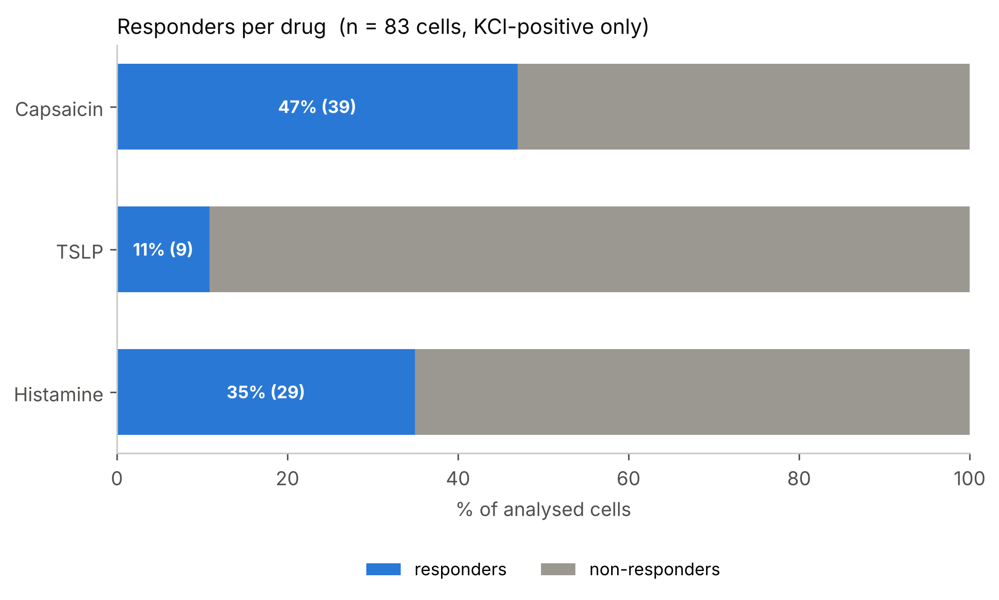
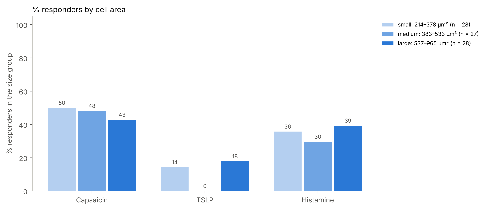

# 7 · Graphs — `make_graphs.py`

Draws the graphs from `multidrug_results/multidrug_results.xlsx`. The analysis is not repeated, so you
can make the graphs again in another format or style at any time.

```bash
cd /path/to/your/experiment          # the folder that contains multidrug_results/
python /path/to/calcium-imaging-pipeline/scripts/make_graphs.py
```

| Question | Default | Options |
|---|---|---|
| Results file | `multidrug_results/multidrug_results.xlsx` | press ENTER; a folder name also works |
| Traces in dF, dF_F0 or norm | `dF` | `norm` = ΔF / ΔF(QC drug), only with quality control |
| Error band SEM or SD | `SEM` | |
| File format png, pdf or svg | `png` | pdf / svg for posters and papers |
| Number of size groups | `3` | small / medium / large with equal numbers of cells |

The graphs are saved in `multidrug_results/graphs/`:

| File | Shows |
|---|---|
| `1_percent_responders` | responders vs non-responders per drug, % of analysed cells with counts |
| `2_traces_responders_vs_non` | mean trace ± error of responders and non-responders, one panel per drug |
| `3_QC_<drug>_kept_vs_excluded` | the cells after adding the QC drug: kept vs excluded |
| `4_venn_drug_overlap` | Venn diagram of responders (2–3 drugs); with 4 or more drugs a bar chart of every combination |
| `5_area_responders_vs_non` | cell area of responders vs non-responders (line = median) |
| `6_percent_responders_by_area` | % responders in small / medium / large cells, with the µm² range of each group |

All graphs use the analysed (QC-positive) cells, except graph 3, which also shows the excluded ones.
Graphs 5 and 6 need the cell size (`cell_size.csv` in the analysis); without it they are skipped.




*(synthetic example data)*

To change colours or labels: the colours are set at the top of `make_graphs.py` (`RESP`, `NONRESP`,
`EXCL`, `DRUG_COLORS`); every graph is one function (`g_percent`, `g_traces`, `g_qc`, `g_venn`, `g_size`).
